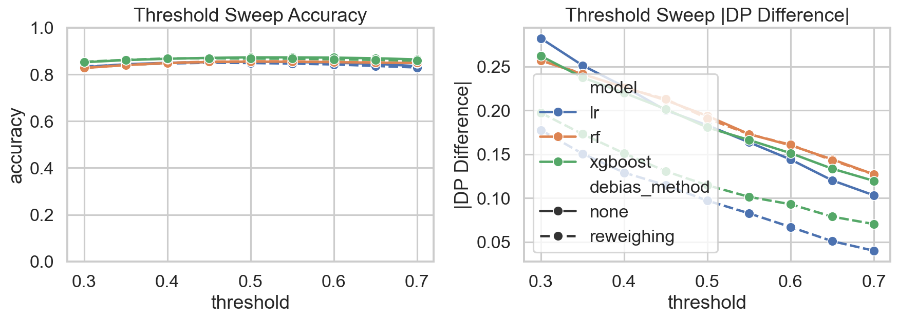

# Fairness Stress Testing for Tabular ML

This repository contains an end-to-end pipeline for measuring and mitigating group unfairness on three benchmark tabular datasets: Adult Income, German Credit, and COMPAS. The project was built for ASU CSE 575 and centers on a simple claim: fairness gains reported at one operating point are often fragile across seeds, thresholds, and subgroups.

## Key results

- **Exponentiated Gradient** cut Logistic Regression demographic parity difference on Adult Income by **89%** (0.174 → 0.019) at a **1.9-point** accuracy cost; the same method on Random Forest cost 6.0 points for a 64% gain.
- **Threshold choice alone** (0.30 → 0.70) cut DP difference **63%** with no debiasing at all.
- Aggregate sex-based DP difference of 0.183 hides a subgroup spread from **6.4%** (non-white women) to **26.6%** (white men) selection rate.
- German Credit DP difference ranged from −0.036 to +0.182 across seeds: small data amplifies fragility.



Full write-up: [docs/report.md](docs/report.md)

## What is implemented

- Dataset loaders for Adult, German, and COMPAS in [code/data_loaders.py](code/data_loaders.py)
- Model builders for logistic regression, random forest, XGBoost, and FT-Transformer in [code/models.py](code/models.py)
- Fairness metrics including demographic parity difference, equal opportunity difference, equalized odds difference, per-group stats, and ECE in [code/fairness_metrics.py](code/fairness_metrics.py)
- Debiasing methods: reweighing, exponentiated gradient, and threshold optimizer in [code/debiasing.py](code/debiasing.py)
- Single-run, grid, and stress-test execution paths in [code/pipeline.py](code/pipeline.py), [code/stress_tests.py](code/stress_tests.py), and [code/run_experiments.py](code/run_experiments.py)
- Figure generation in [code/visualize.py](code/visualize.py)

## Environment

- Python 3.11+
- Create a virtual environment at `.venv`
- Install dependencies with:

```powershell
.\.venv\Scripts\python.exe -m pip install -r requirements.txt
```

Optional GPU install for FT-Transformer:

```powershell
pip install torch --index-url https://download.pytorch.org/whl/cu121
```

## Run the pipeline

Quick baseline:

```powershell
.\.venv\Scripts\python.exe code\run_experiments.py --mode single --datasets adult --models lr --methods none --seeds 0
```

Adult grid across debiasing methods:

```powershell
.\.venv\Scripts\python.exe code\run_experiments.py --mode grid --datasets adult --models lr rf xgboost --methods none reweighing exp_gradient threshold_optimizer --seeds 0 1 2 3 4
```

Stress tests:

```powershell
.\.venv\Scripts\python.exe code\run_experiments.py --mode stress --datasets adult --models lr xgboost --methods none reweighing --seeds 0 1 2 3 4
```

Generate figures:

```powershell
.\.venv\Scripts\python.exe code\visualize.py
```

## Outputs

- Raw and aggregated experiment results are written to `results/`
- Figures are written to `figures/`
- The current report draft is in [docs/report.md](docs/report.md)

## Current status

The classical pipeline paths (`lr`, `rf`, `xgboost`) are runnable end to end. FT-Transformer is implemented and works, but on this machine PyTorch is CPU-only, so full Adult-scale transformer sweeps are substantially slower than the rest of the project.

## Team

Built for ASU CSE 575 (Statistical Machine Learning), Spring 2026, by Devansh Verma, Naman Dewan, Manan Batra, Khushi Thakare, and Anushka Mote.
